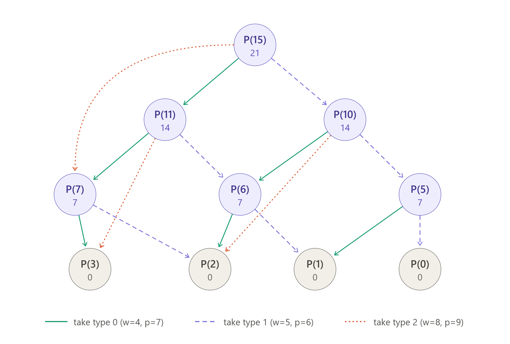

## (1) Recursive definition of P(C)

$$
P(C) =
\begin{cases}
0 & \text{if } w_i > C \text{ for every } i \\
\displaystyle\max_{0 \le i \le n-1,\ w_i \le C} \bigl( P(C - w_i) + p_i \bigr) & \text{otherwise}
\end{cases}
$$

Think about the last object you put into the knapsack, say one of type $i$. Once it's in, the remaining space $C - w_i$ must also be packed as profitably as possible. If it weren't, you could repack that space and get a higher total. Supply is unlimited, so type $i$ can still be used in that smaller problem. The subproblem therefore has the same form as the original, with only the capacity changed.

You don't know which type comes last in the best packing, so you try every type that fits and take the maximum. The first case handles capacities too small for any object, where the profit is 0. Since every $w_i > 0$, this includes the base case $P(0) = 0$.

## (2) Subproblem graph for P(15), with w = (4, 5, 8) and p = (7, 6, 9)



**How to read the graph:**

- **Nodes** are subproblems P(c), with each node's computed value written underneath.
- **Edges** go from $P(c)$ to $P(c - w_i)$, meaning "$P(c)$ depends on $P(c - w_i)$." Each edge stands for putting one object of type $i$ into the knapsack.
- **Gray nodes** (P(3) down to P(0)) are base cases. Nothing fits in them, so their value is 0.

Only 10 distinct subproblems appear, even though a naive recursion tree would contain many repeats. P(7), P(6), P(3), P(1) and P(2) are each reached from more than one parent, with P(2) reached from three. These overlapping subproblems are exactly why dynamic programming beats plain recursion here.

The graph has no cycles, because every edge strictly decreases the capacity. That means we can solve the nodes bottom-up, from small c to large c.

**Final answer:** P(15) = 21, from three type-0 objects (weight 12, profit 21). For comparison:
- 4+4+5 = 13 weight gives profit 20.
- 5+5+5 = 15 weight gives profit 18.
- 8+4 = 12 weight gives profit 16.

## (3) Bottom-up DP algorithm

```
MaxProfit(C, w[0..n-1], p[0..n-1]):
    P[0..C] ← 0
    for i ← 0 to n-1:
        for c ← w[i] to C:
            if P[c − w[i]] + p[i] > P[c]:
                P[c] ← P[c − w[i]] + p[i]
    return P[C]
```

**Explanation:** The algorithm brings in one object type at a time. Let $P_i(c)$ be the maximum profit for capacity $c$ using only types $0, \dots, i$, with $P_{-1}(c) = 0$ because no types are allowed yet. An optimal packing either has no type-$i$ object, or it has at least one. If it has one, removing it leaves capacity $c - w_i$, which must be packed optimally from types $0, \dots, i$, and type $i$ is still allowed because supply is unlimited. This gives

$$
P_i(c) =
\begin{cases}
P_{i-1}(c) & \text{if } w_i > c \\
\max\bigl( P_{i-1}(c),\ P_i(c - w_i) + p_i \bigr) & \text{otherwise}
\end{cases}
$$

After the last pass, $P_{n-1}(c) = P(c)$, the same value the recurrence in (1) defines.

The algorithm keeps a single array instead of a 2D table of $P_i(c)$. Pass $i$ overwrites row $i-1$ in place, and the update stays correct because of the order in which $c$ is visited:

- When pass $i$ reaches $P[c]$, that entry hasn't been touched yet in this pass, so it still holds $P_{i-1}(c)$.
- $P[c - w_i]$ is at a smaller capacity, so it was already updated in this pass and holds $P_i(c - w_i)$. This is what lets type $i$ be used more than once.
- Entries with $c < w_i$ are skipped, so they keep $P_{i-1}(c)$, which matches the first case.

Starting every entry at 0 gives the base case $P_{-1}(c) = 0$.

- **Time:** O(nC). There are $n$ passes, and each pass visits at most $C$ entries.
- **Space:** O(C), for the one-dimensional array.

The direction of the inner loop is what makes this unbounded knapsack. In 0/1 knapsack each object can be used at most once, and the same algorithm works if $c$ runs downward from $C$ to $w_i$. Then $P[c - w_i]$ hasn't been updated yet and still holds $P_{i-1}(c - w_i)$, which means type $i$ has not been used.

## (4) Code and results

The Python implementation is in the file below. It also traces back which objects were chosen.

**(a) P(16), with w = (4, 5, 8) and p = (7, 6, 9)**
```
4a: w=[4, 5, 8], p=[7, 6, 9]
  c   :   0   1   2   3   4   5   6   7   8   9  10  11  12  13  14  15  16
  P(c):   0   0   0   0   7   7   7   7  14  14  14  14  21  21  21  21  28
  P(16) = 28, items used per type = [4, 0, 0]
```
Type 0 has the best profit per unit weight: 7/4 = 1.75, compared with 1.2 for type 1 and 1.125 for type 2. Since 16 is divisible by 4, four type-0 objects fill the knapsack exactly with no wasted space. The table also matches the values in the graph above, for example P(15) = 21.

**(b) P(12), with w = (5, 6, 7) and p = (7, 6, 9)**
```
4b: w=[5, 6, 7], p=[7, 6, 9]
  c   :   0   1   2   3   4   5   6   7   8   9  10  11  12
  P(c):   0   0   0   0   0   7   7   9   9   9  14  14  16
  P(12) = 16, items used per type = [1, 0, 1]
```
Weight 5 + 7 = 12 fills the knapsack exactly, for profit 7 + 9 = 16.

This case shows why DP is needed. A greedy approach that picks the best ratio first (type 0, at 1.4) would take two type-0 objects for weight 10 and profit 14, wasting 2 units of capacity. The DP considers every combination through its subproblems and finds the better mix.

To reproduce part 4's output, run `python3 knapsack.py`.